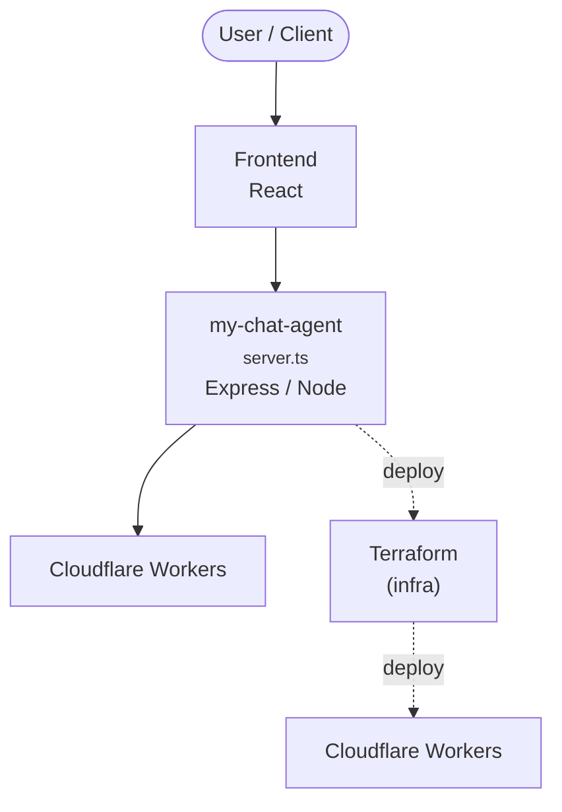

# Context Map — `my-chat-agent`

> Auto-generated architecture & deployment context map. Summarizes the core application, container/cloud footprint, and database connections. Regenerate after significant structural changes.

**Repo:** `avnit/my-chat-agent` · **Original** · Public · Primary language: TypeScript · Default branch: `main` · Files: 58

## 1. Core application

🤖 Chat Agent Starter Kit

- **Frameworks / runtime:** Express / Node, React
- **Entry points:** `src/server.ts`

## 2. Containers & cloud applications

**Cloud deploy / serverless manifests:**
- `wrangler.jsonc`

**Infrastructure as Code:**
- `src/development.tfvars`
- `src/main.tf`
- `src/variables.tf`

**Detected cloud platforms / services:** Cloudflare Workers, Terraform, Vercel

## 3. Database connections

_No database drivers or connection strings detected._

## 4. Architecture diagram

## 5. Security posture

- **Dependabot alerts (open):** 2 critical, 21 high, 26 medium, 12 low

---
_Generated by repo context-mapping pass on 2026-08-13._